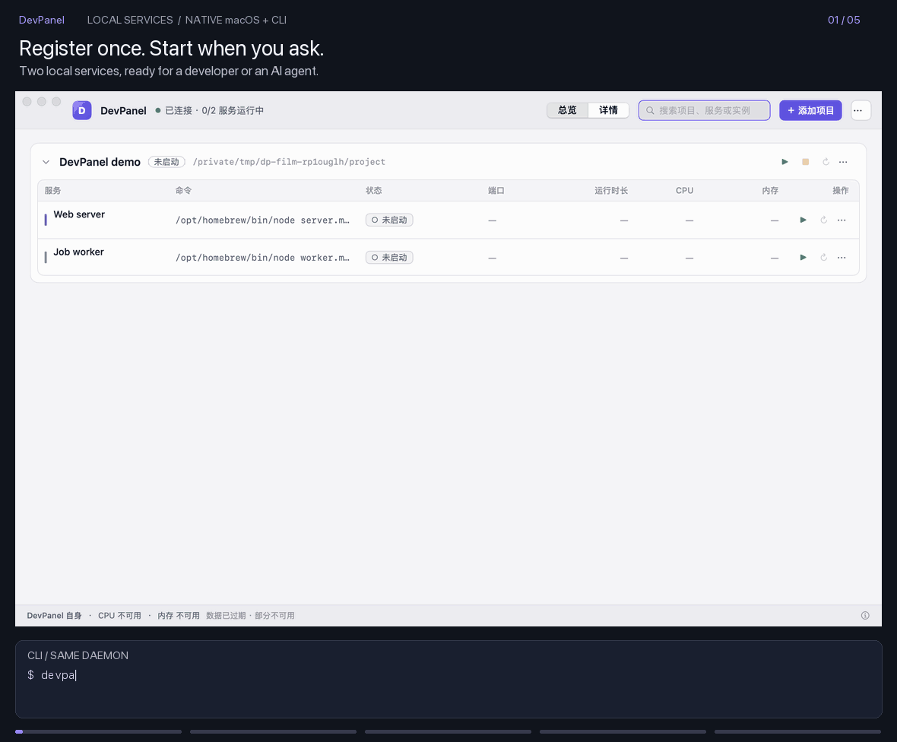

# DevPanel

[English](README.md) | **简体中文**

macOS 上供开发者和 AI 共用的本地项目运行面板：统一启动服务、查看日志与实际端口，并把项目参数留在可检查的配置中。

AI 通过 CLI 注册、启动与查询，人通过原生界面查看、调整和接管。两者使用同一个本地管理服务。保存配置不会执行命令，关闭界面不会停止服务。就绪条件、日志摘要、操作来源与项目动态帮助 AI 确认结果；暂停和锁定帮助人控制 AI 的操作。

- **服务管理**：前台进程托管、实际监听端口、CPU / 内存、历史运行与可调整的启动选项。
- **AI 接入**：JSON CLI、一次性就绪判断、增量日志与摘要、可安装的 Agent skill；无需配置 MCP 服务。
- **人工接管**：原生服务面板、操作来源与动态、暂停和锁定。
- **排障与复用**：检索全部保留日志、对照实际与下次启动配置、复制排障信息，以及带导入预览的脱敏配置分享。
- **并行工作**：为 AI 工作标记来源、筛选动态，并对不同目录的实例分组，保持运行和托管规则独立。
- **工程工具**：快捷操作、Maven 模块与 Profiles、Git 改动与独立差异窗口，支持显式登记多个工程和仓库。

[功能清单与 v0.4 优化建议](docs/features.zh-CN.md) · [试用演示](examples/demo/README.md) · [文档导航](docs/README.md) · [参与贡献](CONTRIBUTING.md) · [第三方声明](THIRD_PARTY_NOTICES.md)

[Releases](https://github.com/CnHugo76/DevPanel/releases) · macOS 14+ · [快速开始](docs/quickstart.zh-CN.md)



25 秒展示隔离环境中的两个真实服务：CLI 启动，原生面板查看状态并接管。[自己试用演示项目](examples/demo/README.md)。

## 系统要求与下载

- macOS 14 或更新版本；发布包按 Apple Silicon / Intel 本机架构分别构建。
- 可下载包见 [Releases](https://github.com/CnHugo76/DevPanel/releases)。v0.4.2 Apple Silicon 安装包已准备好，待上传并公开发布；下载后用随附的 `.sha256` 核验。Intel 用户可在 Intel Mac 上从源码构建。
- App 内含 Node 运行时、管理服务、CLI 与采样辅助进程，使用发布包不需要另装 Node 或保留源码仓库。运行你自己的项目仍需相应的 JDK、包管理器等工具。

解压后将 `DevPanel.app` 放入准备长期保留的位置。首次打开可能被 macOS 拦截：先尝试打开，再到 **系统设置 → 隐私与安全性 → 仍要打开**，按系统提示确认。发布包采用本机 ad-hoc 签名，未做开发者签名或公证。

## 首次打开与 CLI

首次使用可跟随[第一个项目](docs/quickstart.zh-CN.md)，完整包附带不依赖外部 Node 的演示与 Agent skill。

[配置分享、导入预览、独立实例与 AI 工作标识](docs/config-sharing.zh-CN.md)

引导可以跳过，也可以从 DevPanel 菜单的“安装 CLI 与登录启动…”重新打开：

1. 选择命令目录，默认 `~/.local/bin`。界面先展示 `devpanel` / `devpaneld` 的写入路径；目标已存在时展示现有文件内容或软链接目标，确认后才替换。
2. 自行将该目录加入终端和 Agent 的 `PATH`。安装器不修改 shell 配置。
3. “登录时启动管理服务”默认关闭；勾选后使用用户 LaunchAgent，只启动管理服务，不启动项目。

App 优先使用包内 CLI，移动或删除 App 后，已安装的 CLI 链接和登录启动路径需要重新安装。管理服务未运行时可在界面点“启动管理服务”。

```sh
devpanel daemon status --json
devpanel project register --config /path/to/project.json --json
devpanel start <project-id> --wait-ready --json
devpanel logs <project-id> --service backend --digest
devpanel activity <project-id> --json
```

项目 ID 以注册响应为准，命令示例里的占位 ID 不可直接使用。就绪是日志或监听端口的单次信号，不代表业务验证。

## 给 Agent 配置

仓库内的 [skills/devpanel](skills/devpanel/SKILL.md) 提供 DevPanel skill；将该目录安装到所用 Agent 支持的 skill 目录，保留 `references/`。在 **Agent 自身的环境配置** 中设置自报名称，例如 Codex 使用 `DEVPANEL_AGENT=codex`、Claude Code 使用 `DEVPANEL_AGENT=claude-code`。CLI 也支持 `--agent`，名称不是认证。

接入项目时让 Agent 读取实际启动方式、提炼参数并登记就绪条件；注册后显式请求启动。运行后用 `--wait-ready` 得到启动报告，读日志优先用 `--digest`，后续使用 `--after-seq` 读取增量。托管规则只在界面修改；`--override-hold` 只能用于用户在本轮对话中明确要求的启动。

## 从源码构建

需要 Node ≥24、pnpm 12、Xcode 工具链与 macOS。下载或检出本仓库，在仓库根目录执行：

```sh
pnpm install --frozen-lockfile
export DEVPANEL_HOME="$(mktemp -d /tmp/dp-build.XXXXXX)"
export DEVPANEL_PORT=0
pnpm typecheck
pnpm test
swift build --package-path apps/mac
swift test --package-path apps/mac
apps/mac/scripts/bundle.sh
```

`apps/mac/build/DevPanel.app` 是界面开发包。独立运行所需的完整分发包另用：

```sh
VERSION=0.4.2 pnpm release:local
node scripts/release-smoke.mjs
```

发布脚本从 Node.js 官方站点获取固定版本的当前架构运行时并核验 SHA-256，复制生产依赖和原生采样器，执行 ad-hoc 签名，在 `.devpanel-dev/codex/v04/release/` 生成 App、ZIP 与校验文件。它不安装、不推送、不创建标签或 GitHub Release。单独构建另一架构需在对应 Mac 上执行；不承诺通用二进制。

ZIP 文件名包含 `macos-arm64` 或 `macos-x64`，校验文件内使用相同文件名。完整开发流程与提交约定见 [CONTRIBUTING.md](CONTRIBUTING.md)。

开发与测试始终使用短路径临时 `DEVPANEL_HOME`，Unix socket 路径在 macOS 上须 ≤103 字节。源码 CLI 使用 `node packages/cli/src/main.ts`。开发安装入口必须显式指定临时目录：`pnpm setup:cli --bin-dir /tmp/devpanel-bin`。不要让开发包连接日常数据，或替换正在使用的 App、CLI、daemon。

## 数据与升级

默认数据目录为 `~/Library/Application Support/DevPanel`，包含项目配置、敏感值、运行记录和有上限的日志；目录为 0700、文件为 0600。`DEVPANEL_HOME` 可切换独立环境。移除项目不删除项目源码。敏感值按标记遮盖；应用自行编码或变形后的秘密无法自动识别。

从手工稳定版迁移到完整 App 的步骤见 [迁移说明](docs/release-v0.4.md)。升级前先停止受管服务并备份数据，再切换 App、CLI 和登录项。同一数据目录只允许一个 daemon；旧版和新版可保留在不同目录，不能同时管理同一份数据。稳定版升级、版本标签、GitHub 发布由用户决定。

## 卸载

先确认可以停止受管服务，再执行 `devpanel daemon uninstall --stop-services` 移除登录项（未安装登录项时无副作用），并执行 `devpanel daemon stop --stop-services` 确认手动启动的管理服务也已停止；若提示不可达，表示当前已停止。退出界面后，删除 App 及所选命令目录里的 `devpanel` / `devpaneld` 链接，删除前核对它们确实指向该 App。

是否删除数据目录由你决定；保留它便于重新安装后继续使用。卸载不会删除任何项目源码，也不会修改 shell 配置。

## 已知限制

- 只管理由 DevPanel 启动的本机前台进程；不接管已有进程，不支持容器与远程主机。
- 没有自动重启、HTTP 就绪探测、持续健康检查、服务依赖编排或 AI 诊断。
- 暂停、锁定与 AI 强制停止限制用于防误操作；同用户程序可取得本地接口凭据，它们不是安全边界。
- daemon 故障后不能接回旧管道时会显示未知状态和日志缺口，不承诺无损恢复。
- 未做公证、自动更新、包管理器分发或 Linux / Windows 安装包。干净 Mac 的完整安装交互仍需人工验收。
- 当前原生界面主要使用简体中文；中英文 README 不代表应用界面已完成多语言支持。

## 许可证

采用 [MIT License](LICENSE)，允许商用、修改和再分发，须保留版权和许可声明。第三方组件按各自的 [许可证声明](THIRD_PARTY_NOTICES.md) 分发。
